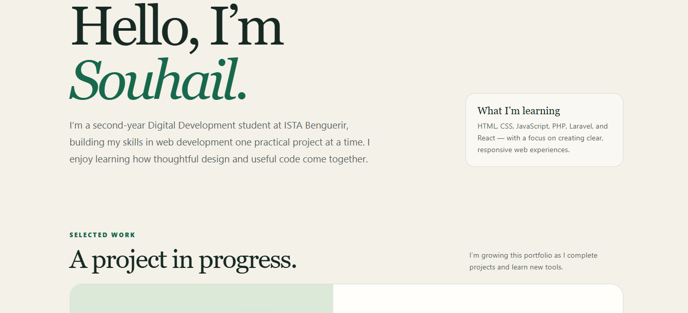
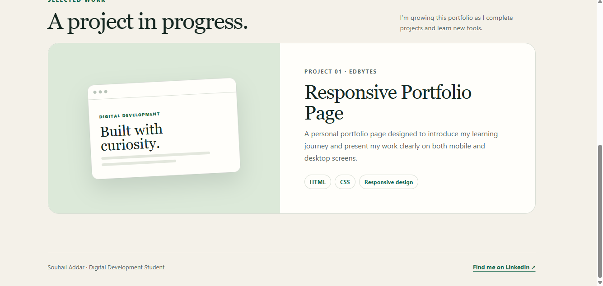
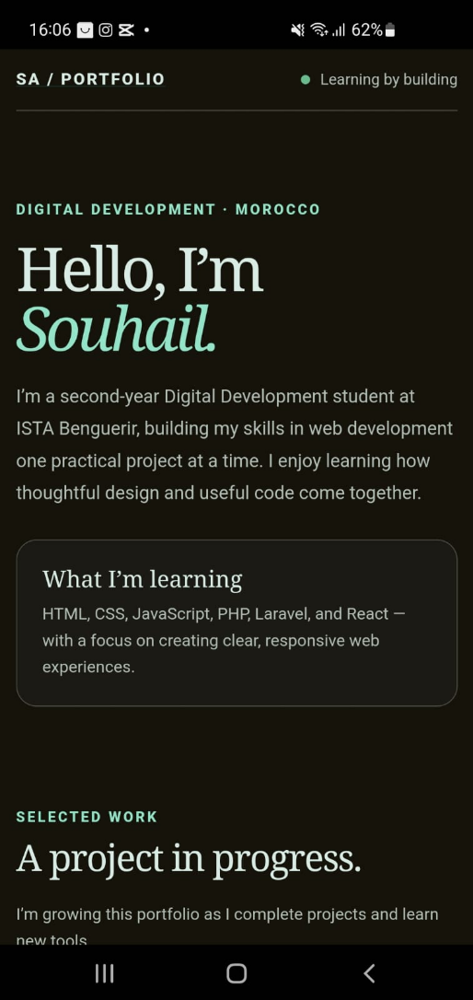
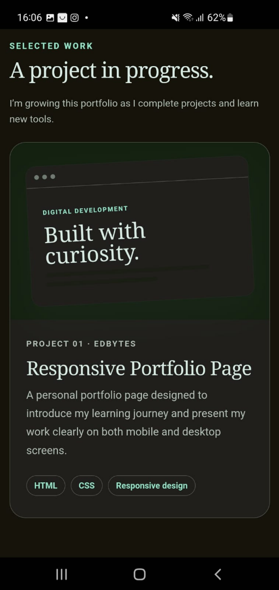
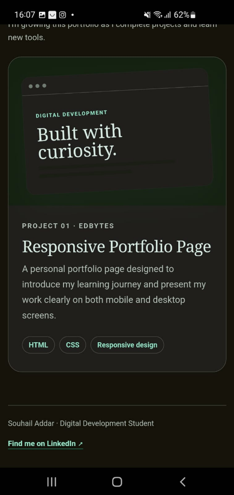

# Souhail Addar — Portfolio page

Responsive portfolio created for the EdBytes Full Stack Web Development internship task.

[View the live portfolio](https://addar-souhail.github.io/souhail-portfolio/)

## What it includes

- Personal introduction
- Project card with a title and short description
- Responsive layouts for mobile and desktop screens
- HTML and CSS, with no external assets

## Screenshots

### Desktop

### Mobile

